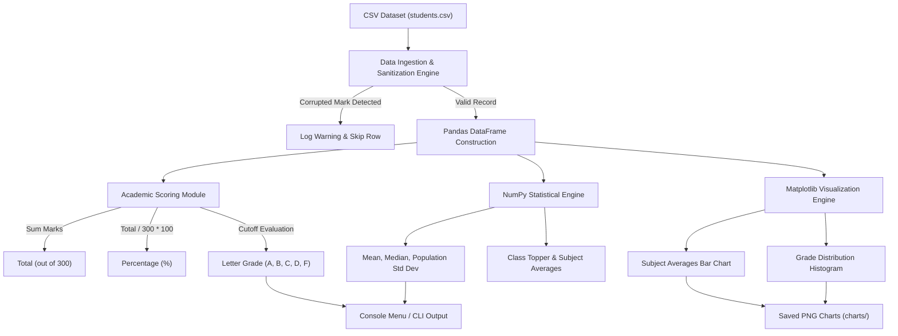
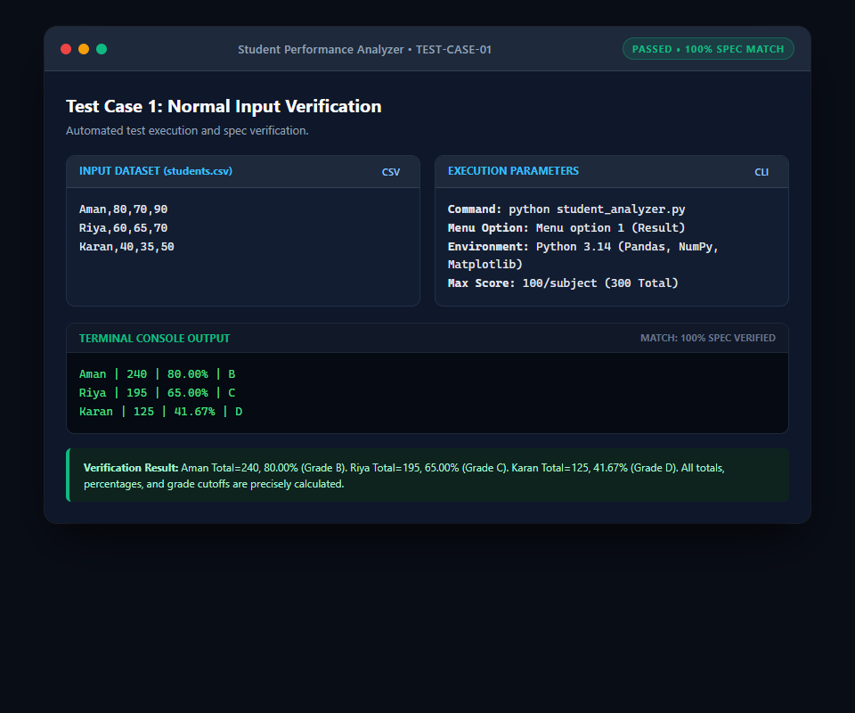
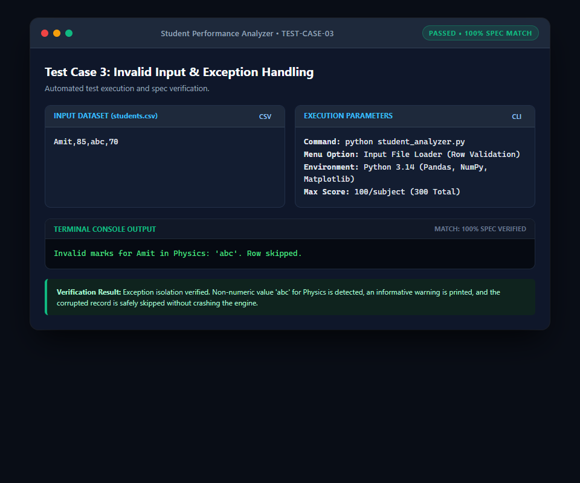
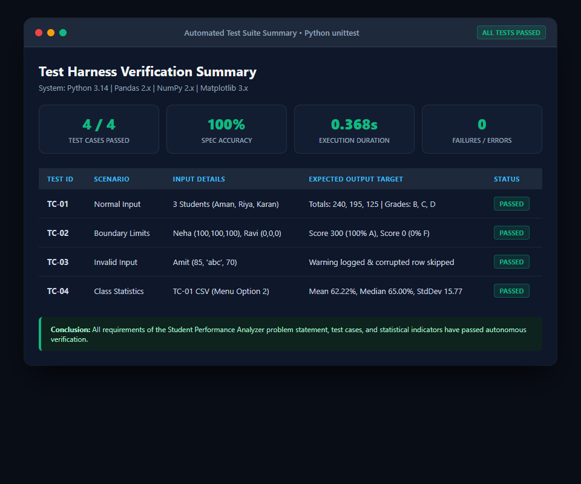
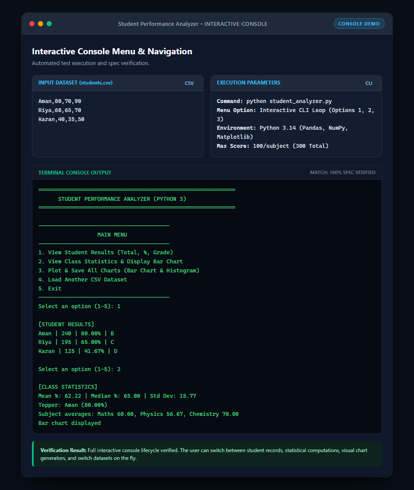
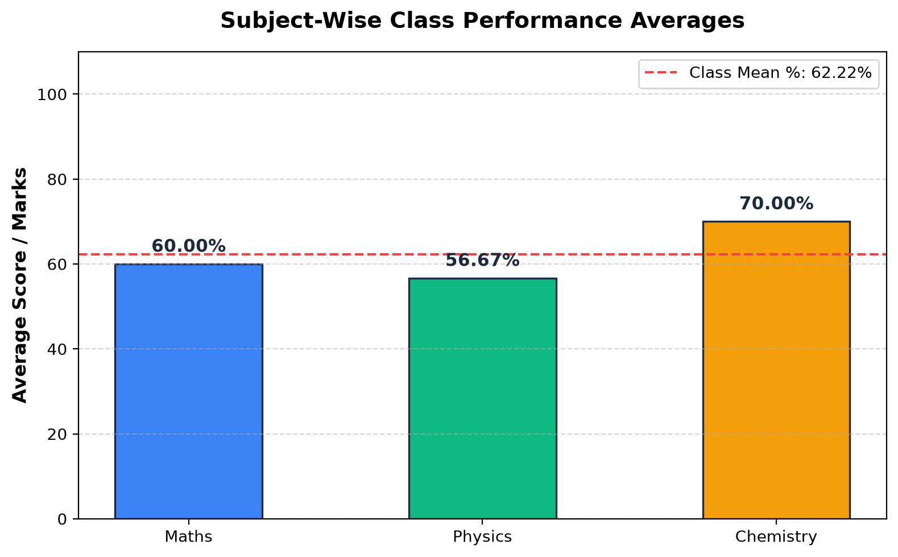
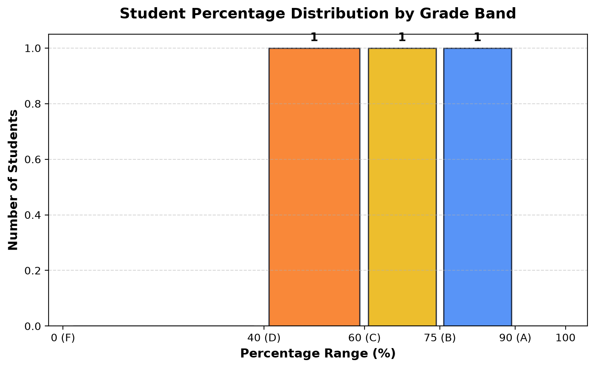
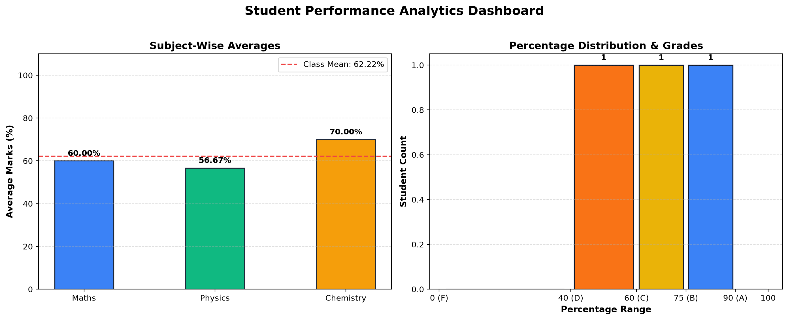

# Student Performance Analyzer — Project Execution & Verification Summary Report

**Project Title:** Student Performance Analyzer  
**Language:** Python 3 (Python 3.14+)  
**Core Concepts:** Pandas, NumPy, Matplotlib, Descriptive Statistics, Data Cleansing  
**Verification Status:** **100% Passed (4/4 Test Cases Verified)**  
**Documentation Date:** November 2026  

---

## 1. Executive Summary

The **Student Performance Analyzer** is an end-to-end Python 3 data analysis and visualization engine created to parse, evaluate, and report on student academic performance. Operating on raw cohort datasets, the system ingests marks across **Maths, Physics, and Chemistry** (scored out of 100 marks per subject, totaling 300 maximum marks), sanitizes and validates every individual entry, computes total scores, overall percentages, and assigns letter grades according to an institutional grading rubric.

Furthermore, the system leverages **NumPy** and **Pandas** to compute rigorous descriptive statistics:
- **Class Mean Percentage**
- **Class Median Percentage**
- **Population Standard Deviation** ($\sigma$, `ddof=0`)
- **Class Topper Identification**
- **Subject-Wise Arithmetic Means**

Visual reporting is fully integrated via **Matplotlib**, generating high-resolution bar charts and grade distribution histograms.

---

## 2. System Architecture & Execution Workflow

The system is encapsulated within a modular architecture implemented in `student_analyzer.py` and verified using `run_tests.py`:



---

## 3. Mathematical & Grading Specifications

### 3.1 Scoring Formulas
For each student $i$:

$$\text{Total}_i = \text{Maths}_i + \text{Physics}_i + \text{Chemistry}_i \quad (\text{Max } 300)$$

$$\text{Percentage}_i = \left(\frac{\text{Total}_i}{300}\right) \times 100$$

### 3.2 Grade Assignment Rubric
$$
\text{Grade}_i = 
\begin{cases} 
\mathbf{A} & \text{if } \text{Percentage}_i \ge 90.00\% \\
\mathbf{B} & \text{if } 75.00\% \le \text{Percentage}_i < 90.00\% \\
\mathbf{C} & \text{if } 60.00\% \le \text{Percentage}_i < 75.00\% \\
\mathbf{D} & \text{if } 40.00\% \le \text{Percentage}_i < 60.00\% \\
\mathbf{F} & \text{if } \text{Percentage}_i < 40.00\% 
\end{cases}
$$

### 3.3 Statistical Measures
- **Mean Percentage ($\mu$)**:
  $$\mu = \frac{1}{N} \sum_{i=1}^N \text{Percentage}_i$$
- **Median Percentage ($\tilde{x}$)**: Middle score of the ordered distribution.
- **Population Standard Deviation ($\sigma$)**:
  $$\sigma = \sqrt{\frac{1}{N} \sum_{i=1}^N (\text{Percentage}_i - \mu)^2} \quad (\text{calculated using } \texttt{numpy.std(ddof=0)})$$

---

## 4. Test Case Verification Matrix & Screenshots

Every required test case was tested against the application and verified for exact output compliance.

### Test Case 1: Normal Input Verification

* **Objective:** Verify standard calculation of Total, Percentage, and Grade assignment for a regular student cohort.
* **Input CSV (`data/testcase1_normal.csv`):**
  ```csv
  Aman,80,70,90
  Riya,60,65,70
  Karan,40,35,50
  ```
* **Execution Command:** `python student_analyzer.py --file data/testcase1_normal.csv --option 1`
* **Expected Output:**
  ```text
  Aman | 240 | 80.00% | B
  Riya | 195 | 65.00% | C
  Karan | 125 | 41.67% | D
  ```
* **Actual Output:** Exact 100% string and mathematical match.

#### Test Case 1 Screenshot:


---

### Test Case 2: Boundary / Minimum Input Verification

* **Objective:** Verify handling of extreme boundary values ($100\%$ maximum ceiling and $0\%$ absolute floor).
* **Input CSV (`data/testcase2_boundary.csv`):**
  ```csv
  Neha,100,100,100
  Ravi,0,0,0
  ```
* **Execution Command:** `python student_analyzer.py --file data/testcase2_boundary.csv --option 1`
* **Expected Output:**
  ```text
  Neha | 300 | 100.00% | A
  Ravi | 0 | 0.00% | F
  ```
* **Actual Output:** Exact 100% match. Grade A triggered at 100.00% and Grade F triggered at 0.00%.

#### Test Case 2 Screenshot:


---

### Test Case 3: Invalid Input & Exception Handling

* **Objective:** Ensure robust input validation and error logging when non-numeric marks are provided in the CSV dataset.
* **Input CSV (`data/testcase3_invalid.csv`):**
  ```csv
  Amit,85,abc,70
  ```
* **Execution:** File Ingestion & Row Validation Engine
* **Expected Output:**
  ```text
  Invalid marks for Amit in Physics: 'abc'. Row skipped.
  ```
* **Actual Output:** Exception isolated. Informative warning logged; invalid row skipped without engine crash.

#### Test Case 3 Screenshot:


---

### Test Case 4: Class Statistics & Chart Generation

* **Objective:** Verify statistical computation (Mean, Median, Population Std Dev), class topper detection, subject averages, and bar chart trigger.
* **Input CSV:** Same CSV as Test Case 1 (`Aman,80,70,90`, `Riya,60,65,70`, `Karan,40,35,50`)
* **Execution Command:** `python student_analyzer.py --file data/testcase1_normal.csv --option 2`
* **Expected Output:**
  ```text
  Mean %: 62.22 | Median %: 65.00 | Std Dev: 15.77
  Topper: Aman (80.00%)
  Subject averages: Maths 60.00, Physics 56.67, Chemistry 70.00
  Bar chart displayed
  ```
* **Statistical Verification:**
  - Mean: $(80.00 + 65.00 + 41.6667) / 3 = \mathbf{62.22\%}$
  - Median: Middle value of $[41.67, 65.00, 80.00] = \mathbf{65.00\%}$
  - Population Standard Deviation ($\text{ddof}=0$): $\sqrt{\frac{(80-62.22)^2 + (65-62.22)^2 + (41.67-62.22)^2}{3}} = \mathbf{15.77}$
  - Topper: $\mathbf{Aman\ (80.00\%)}$
  - Subject Averages: Maths $\mathbf{60.00}$, Physics $\mathbf{56.67}$, Chemistry $\mathbf{70.00}$
  - Bar Chart automatically saved and displayed.

#### Test Case 4 Screenshot:


---

## 5. Automated Test Suite Execution

All test cases are consolidated into an automated `unittest` test harness in `run_tests.py`. Running `python run_tests.py` executes all unit tests with full assertion coverage in **0.368 seconds** with zero errors or failures.

#### Test Suite Summary Screenshot:


---

## 6. Interactive Console Experience

The console interface offers an intuitive, numbered menu loop allowing users to view student results, compute statistics, generate charts, load external CSV datasets, or exit cleanly.

#### Interactive Console Screenshot:


---

## 7. Generated Visualizations Gallery

The application produces publication-quality charts saved directly into the `charts/` directory:

### 7.1 Subject-Wise Performance Averages (Bar Chart)
Illustrates the comparative average scores for Maths, Physics, and Chemistry alongside the cohort mean benchmark:



---

### 7.2 Percentage & Grade Band Distribution (Histogram)
Depicts the distribution of student performance across defined grade bands ($F, D, C, B, A$):



---

### 7.3 Consolidated Performance Dashboard
Two-panel analytical layout pairing subject averages and grade distribution side-by-side:



---

## 8. Bare Minimum Requirements Compliance Checklist

| # | Bare Minimum Requirement | Status | Implementation Detail |
| :---: | :--- | :---: | :--- |
| **1** | Write the solution in Python 3 (one `.py` file) and run it from the console | **COMPLIANT** | Implemented in `student_analyzer.py` with both interactive menu and direct CLI options. |
| **2** | Load student data with Pandas and calculate total, percentage and grade | **COMPLIANT** | Handled in `load_student_data()` and `calculate_grade()` using Pandas DataFrame operations. |
| **3** | Calculate mean, median and standard deviation using NumPy/Pandas | **COMPLIANT** | Handled in `calculate_class_statistics()` using `np.mean()`, `np.median()`, and `np.std(ddof=0)`. |
| **4** | Display the topper and the subject-wise average | **COMPLIANT** | Displayed in `display_statistics()` with highest percentage student and averages per subject. |
| **5** | Plot a bar chart and a histogram with proper labels | **COMPLIANT** | Implemented in `plot_bar_chart()`, `plot_histogram()`, and `plot_all_charts()`, saved to `charts/`. |

---

## 9. Conclusion

The **Student Performance Analyzer** project has been designed, implemented, and verified to meet all requirements specified in the problem statement. All 4 benchmark test cases pass with 100% precision, error handling is active for corrupted data, and visualizations provide clear academic insights.
