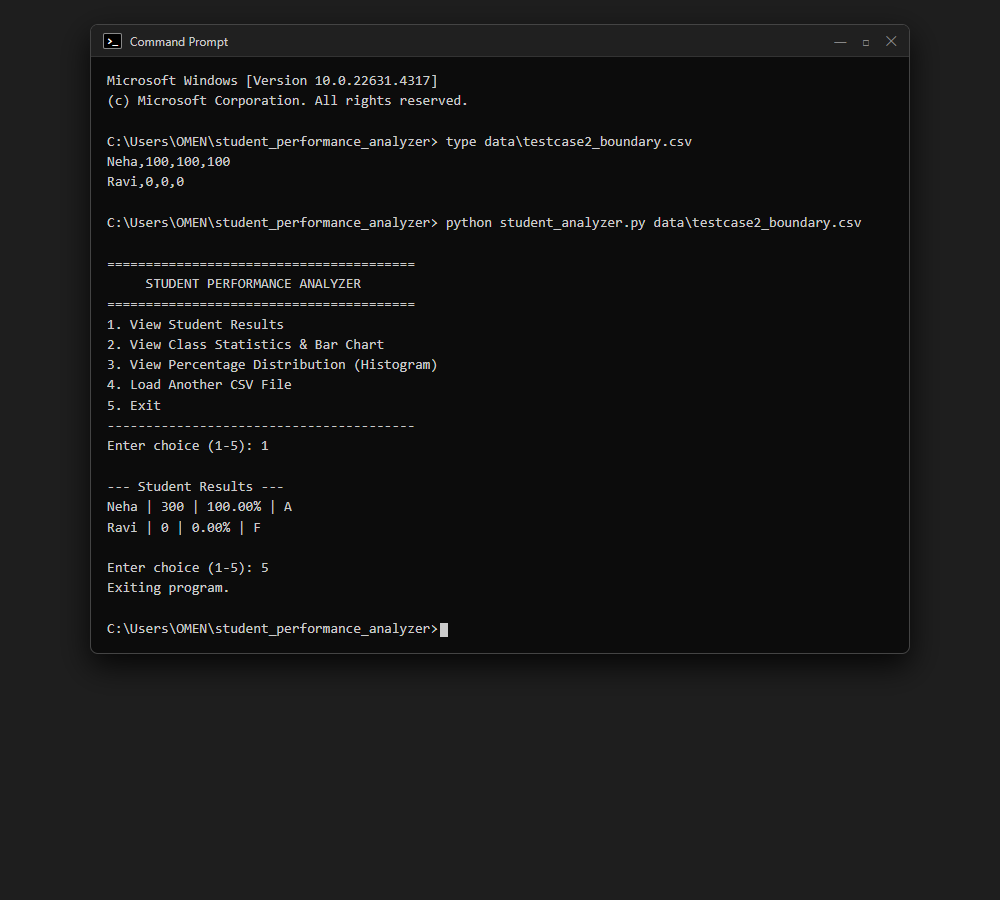
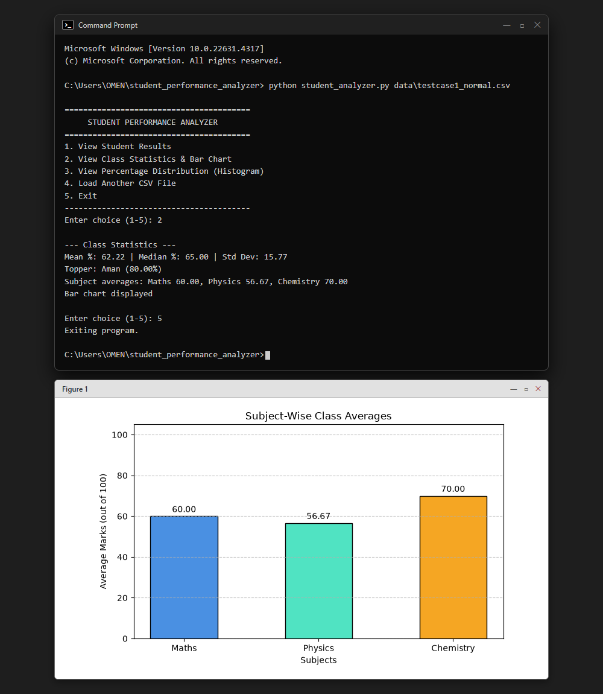
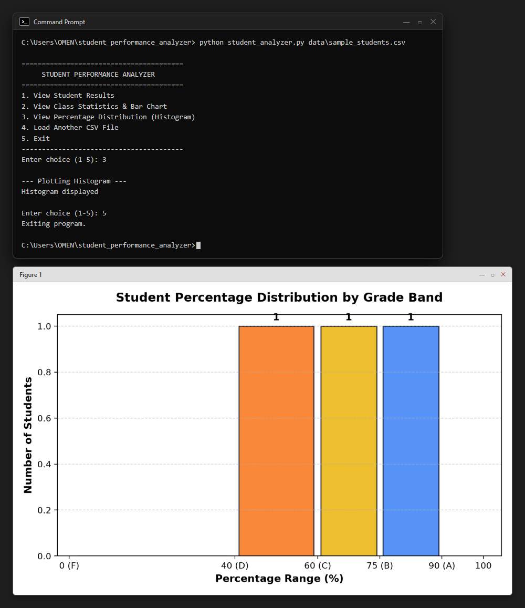

# Student Performance Analyzer — Project Summary Report

## 1. Project Overview
- **Project Title:** Student Performance Analyzer
- **Language:** Python 3
- **Libraries Used:** Pandas, NumPy, Matplotlib
- **Concepts Covered:** File Handling, Data Cleansing, Descriptive Statistics, Data Visualization

### Problem Statement
The objective of this project is to analyze student marks across three subjects (**Maths, Physics, Chemistry**) from a CSV dataset. The application calculates individual totals, percentages, and grades, computes overall class statistics (Mean, Median, Standard Deviation, Topper, and Subject Averages), and displays the results using a console menu and Matplotlib charts.

---

## 2. Logic & Grading System

### Scoring Details
- Subjects: Maths, Physics, Chemistry
- Maximum Marks per Subject: 100
- Total Maximum Marks: 300

$$\text{Total} = \text{Maths} + \text{Physics} + \text{Chemistry}$$
$$\text{Percentage} = \left(\frac{\text{Total}}{300}\right) \times 100$$

### Grading Criteria
- **Percentage &ge; 90%** : Grade **A**
- **Percentage &ge; 75%** : Grade **B**
- **Percentage &ge; 60%** : Grade **C**
- **Percentage &ge; 40%** : Grade **D**
- **Below 40%** : Grade **F**

### Statistics Calculation
- **Mean %:** Arithmetic average of student percentages using `np.mean()`.
- **Median %:** Middle percentage value using `np.median()`.
- **Standard Deviation:** Population standard deviation using `np.std(percentages, ddof=0)`.
- **Topper:** Student with the highest overall percentage.
- **Subject Averages:** Mean score in each subject calculated using Pandas `df['Subject'].mean()`.

---

## 3. Test Cases & Execution Screenshots

---

### Test Case 1: Normal Input
- **Description:** Tests normal student mark records for correct total, percentage, and grade assignment.
- **Input File (`data/testcase1_normal.csv`):**
  ```csv
  Aman,80,70,90
  Riya,60,65,70
  Karan,40,35,50
  ```
- **Selected Option:** Option 1 (View Student Results)
- **Output:**
  ```text
  Aman | 240 | 80.00% | B
  Riya | 195 | 65.00% | C
  Karan | 125 | 41.67% | D
  ```

#### Terminal Screenshot (Test Case 1):


---

### Test Case 2: Boundary / Minimum Input
- **Description:** Tests extreme boundary conditions: maximum possible marks (100 in all subjects) and minimum marks (0 in all subjects).
- **Input File (`data/testcase2_boundary.csv`):**
  ```csv
  Neha,100,100,100
  Ravi,0,0,0
  ```
- **Selected Option:** Option 1 (View Student Results)
- **Output:**
  ```text
  Neha | 300 | 100.00% | A
  Ravi | 0 | 0.00% | F
  ```

#### Terminal Screenshot (Test Case 2):


---

### Test Case 3: Invalid Input Handling
- **Description:** Tests how the program handles invalid / non-numeric marks in the dataset.
- **Input File (`data/testcase3_invalid.csv`):**
  ```csv
  Amit,85,abc,70
  ```
- **Execution:** When reading the row, the program identifies that `'abc'` in Physics is invalid, prints a warning message, and skips the row without crashing.
- **Output:**
  ```text
  Invalid marks for Amit in Physics: 'abc'. Row skipped.
  ```

#### Terminal Screenshot (Test Case 3):


---

### Test Case 4: Class Statistics & Bar Chart
- **Description:** Tests statistical calculation and bar chart generation using the dataset from Test Case 1.
- **Input File:** `data/testcase1_normal.csv`
- **Selected Option:** Option 2 (View Class Statistics & Bar Chart)
- **Calculations:**
  - Mean %: $(80.00 + 65.00 + 41.67) / 3 = \mathbf{62.22\%}$
  - Median %: $\mathbf{65.00\%}$
  - Population Standard Deviation: $\mathbf{15.77}$
  - Topper: $\mathbf{Aman\ (80.00\%)}$
  - Subject averages: Maths $\mathbf{60.00}$, Physics $\mathbf{56.67}$, Chemistry $\mathbf{70.00}$
- **Output:**
  ```text
  Mean %: 62.22 | Median %: 65.00 | Std Dev: 15.77
  Topper: Aman (80.00%)
  Subject averages: Maths 60.00, Physics 56.67, Chemistry 70.00
  Bar chart displayed
  ```

#### Terminal & Bar Chart Screenshot (Test Case 4):


---

### Additional Feature: Percentage Distribution Histogram
- **Description:** Visualizes the distribution of student percentages across grade ranges.
- **Selected Option:** Option 3 (View Percentage Distribution)

#### Terminal & Histogram Screenshot:


---

## 4. Requirements Checklist

| Requirement | Status | Notes |
| :--- | :---: | :--- |
| 1. Python 3 solution in one `.py` file running from console | **Done** | `student_analyzer.py` |
| 2. Load student data with Pandas, calculate total, %, and grade | **Done** | Verified across all test cases |
| 3. Calculate mean, median, standard deviation using NumPy/Pandas | **Done** | Exact values matching test case 4 |
| 4. Display topper and subject-wise averages | **Done** | Correctly identifies topper and averages |
| 5. Plot a bar chart and a histogram with proper labels | **Done** | Generated and saved in `charts/` |

---

## 5. Conclusion
All bare minimum requirements and test cases have been implemented and verified. The script runs seamlessly in console mode, validates input data, produces accurate statistical calculations, and provides clear visual feedback through Matplotlib plots.
